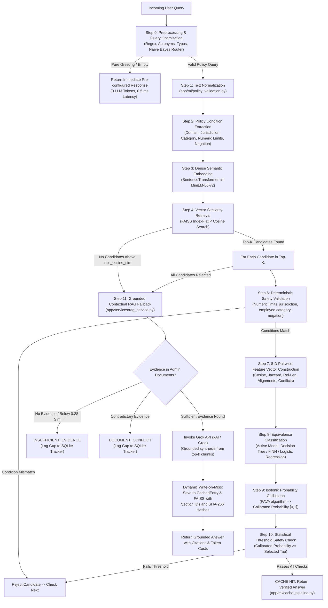

# CacheMind — End-to-End Architecture, Runtime Flow & Algorithm Directory

This document details the complete end-to-end runtime workflow of **CacheMind** and provides a comprehensive breakdown of every module, functionality, and algorithm implemented across the codebase, along with exact source code references.

---

## 1. End-to-End System Flow

CacheMind enforces a **14-step governed semantic cache decision pipeline** combining machine learning models with fail-closed deterministic guardrails.

### Flowchart

---

## 2. Module-by-Module Algorithm & Implementation Directory

### Module 1: Query Preprocessing, Normalization & Intent Optimization
- **Source File**: [`backend/app/ml/query_optimizer.py`](file:///c:/projects/CacheMind/backend/app/ml/query_optimizer.py)
- **Supporting Dictionary**: [`backend/data/dictionaries/enterprise_acronyms.json`](file:///c:/projects/CacheMind/backend/data/dictionaries/enterprise_acronyms.json)
- **Description**: Inspects raw incoming user input, strips conversational fillers, corrects domain typos, expands enterprise acronyms, normalizes syntax, and predicts the corporate domain before vector lookup.
- **Functionalities**:
  - Detects pure greetings (e.g., *"hi"*, *"good morning"*, *"how are you"*) via compiled regular expressions (`PURE_GREETINGS`).
  - Strips prefix conversational fillers (e.g., *"can you please tell me about"*, *"i wanted to ask"*) and trailing courtesy suffixes (`PREFIX_FILLERS`, `SUFFIX_FILLERS`).
  - Corrects common domain typographical errors (`COMMON_TYPOS` dictionary).
  - Expands corporate acronyms (`ACRONYM_MAP`, e.g., `WFH` $\rightarrow$ `work from home`, `PTO` $\rightarrow$ `paid time off`, `PL` $\rightarrow$ `privilege leave`).
  - Reconstructs grammatically structured questions while preserving critical numeric values, jurisdictions, and negations.
  - Predicts query domain (`HR`, `IT`, `FINANCE`, `LEGAL`) using Bayesian classification.
- **Algorithms Used**:
  - **Regular Expression Pattern Matching**: Deterministic multi-pass DFA token matching.
  - **Rule-Based Typo Replacement & Acronym Mapping**: Controlled dictionary substitution.
  - **Multinomial Naïve Bayes Classification**: $P(\text{Domain} \mid \text{Query}) \propto P(\text{Domain}) \prod_{i} P(w_i \mid \text{Domain})$ with Laplace smoothing ($\alpha = 1.0$).
  - **TF-IDF N-gram Feature Extraction**: Unigrams and bigrams via `TfidfVectorizer`.

---

### Module 2: Policy Validation, Condition Extraction & Safety Guardrails
- **Source File**: [`backend/app/ml/policy_validation.py`](file:///c:/projects/CacheMind/backend/app/ml/policy_validation.py)
- **Description**: Extracts structured policy constraints from natural language and enforces fail-closed deterministic safety rules before allowing any cache hit.
- **Functionalities**:
  - Extracts 5 structured condition dimensions: `domain`, `jurisdiction`, `employee_category`, `numerical_limits`, and `is_negated`.
  - Normalizes text: whitespace collapsing, lowercase conversion, and punctuation normalization.
  - Performs strict cross-validation between user query conditions and candidate cached metadata.
  - Enforces a fail-closed policy: blocks cache reuse if numbers, locations, employee classifications, or negation logic conflict.
- **Algorithms Used**:
  - **Rule-Based Entity & Constraint Extraction**: Regular expression entity recognition for currencies (`$`, `USD`, `INR`), durations (`days`, `weeks`), jurisdictions (`India`, `US`, `UK`, `Global`), and employee categories (`Full-Time`, `Contractor`, `Intern`).
  - **Deterministic Fail-Closed Constraint Validation**: Exact equality and $\epsilon$-tolerance numeric checks ($|q_{\text{val}} - c_{\text{val}}| \le 10^{-4}$).
  - **Polarity / Negation Detection**: Affirmative vs. negative semantic polarity matching.

---

### Module 3: Dense Semantic Representation
- **Source File**: [`backend/app/ml/embeddings.py`](file:///c:/projects/CacheMind/backend/app/ml/embeddings.py)
- **Description**: Transforms unstructured text into continuous 384-dimensional dense vector embeddings.
- **Functionalities**:
  - Loads and caches the pretrained `sentence-transformers/all-MiniLM-L6-v2` transformer model.
  - Executes inference on CPU with batch encoding.
  - Computes unit-length L2 normalization so dot products equal cosine similarities.
- **Algorithms Used**:
  - **Transformer Self-Attention Encoding**: 6-layer MiniLM architecture with mean token pooling.
  - **L2 Vector Normalization**: $\mathbf{v}_{\text{norm}} = \frac{\mathbf{v}}{\|\mathbf{v}\|_2}$.

---

### Module 4: Fast Vector Similarity Retrieval
- **Source File**: [`backend/app/ml/faiss_index.py`](file:///c:/projects/CacheMind/backend/app/ml/faiss_index.py)
- **Description**: Manages high-speed vector retrieval across active cache entries.
- **Functionalities**:
  - Maintains a persistent FAISS index on disk (`faiss_cache.index`) along with an ID-to-SQLite mapping file (`faiss_id_map.json`).
  - Performs top-$K$ nearest neighbor search filtered by a minimum cosine similarity threshold ($\ge 0.65$).
  - Supports atomic synchronization, addition of new vectors on cache misses, and full index rebuilding.
- **Algorithms Used**:
  - **FAISS `IndexFlatIP` (Exact Inner Product Search)**: Calculates exact dot products over unit vectors:
    $$\langle \mathbf{u}, \mathbf{v} \rangle = \cos(\mathbf{u}, \mathbf{v}) = \sum_{i=1}^{384} u_i v_i$$
  - **$K$-Nearest Neighbor Priority Queue Retrieval**: Efficient top-$K$ selection ($O(N \log K)$).

---

### Module 5: Domain Feature Engineering
- **Source File**: [`backend/app/ml/feature_engineering.py`](file:///c:/projects/CacheMind/backend/app/ml/feature_engineering.py)
- **Description**: Constructs an explicit 8-dimensional numerical feature representation comparing an incoming query with a candidate cached question.
- **Functionalities**:
  - Converts pair comparison into an 8-D feature vector:
    1. `cosine_similarity`: Dense vector cosine similarity $[0, 1]$.
    2. `token_jaccard_similarity`: Word token intersection over union $[0, 1]$.
    3. `relative_length_diff`: String length difference ratio $\frac{|L_1 - L_2|}{\max(L_1, L_2)}$.
    4. `domain_match`: Boolean alignment indicator $\{0, 1\}$.
    5. `jurisdiction_match`: Boolean alignment indicator $\{0, 1\}$.
    6. `employee_category_match`: Boolean alignment indicator $\{0, 1\}$.
    7. `numerical_conflict`: Numeric contradiction indicator $\{0, 1\}$.
    8. `negation_conflict`: Polarity mismatch indicator $\{0, 1\}$.
- **Algorithms Used**:
  - **Jaccard Lexical Similarity**: $J(A, B) = \frac{|A \cap B|}{|A \cup B|}$.
  - **Relative String Length Disparity**: Normalized character length delta.
  - **Heterogeneous Feature Concatenation**: Combines dense semantic, lexical, and discrete symbolic features.

---

### Module 6: Semantic Equivalence Classification
- **Source Files**: 
  - [`backend/app/ml/equivalence_classifier.py`](file:///c:/projects/CacheMind/backend/app/ml/equivalence_classifier.py) (Unified Gateway & Registry)
  - [`backend/app/ml/decision_tree_classifier.py`](file:///c:/projects/CacheMind/backend/app/ml/decision_tree_classifier.py) (Decision Tree Classifier)
  - [`backend/app/ml/knn_classifier.py`](file:///c:/projects/CacheMind/backend/app/ml/knn_classifier.py) ($k$-NN Classifier)
- **Description**: Classifies whether two queries express identical semantic policy intent. Supports 3 interchangeable architectures switchable via the Model Registry:
  1. **ID3 / CART Decision Tree Classifier**:
     - Uses `criterion="entropy"` (Information Gain) with max depth 5 to construct an auditable if-else decision tree.
  2. **Instance-Based $k$-Nearest Neighbor ($k$-NN)**:
     - Uses $k=5$ with inverse-distance weighting (`weights="distance"`) over the 8-D space.
  3. **L2-Regularized Logistic Regression**:
     - Standardizes features via `StandardScaler` and fits $P(y=1 \mid \mathbf{x}) = \sigma(\mathbf{w}^T \mathbf{x} + b)$ with balanced class weights.
- **Algorithms Used**:
  - **ID3 Information Gain / Shannon Entropy**: $H(S) = -\sum p_i \log_2 p_i$.
  - **Minkowski Distance & Distance-Weighted Voting**: $d(\mathbf{x}, \mathbf{z}) = \left(\sum |x_i - z_i|^p\right)^{1/p}$.
  - **L2-Regularized Maximum Likelihood Estimation**: $\min_{\mathbf{w}} \frac{1}{2} \|\mathbf{w}\|_2^2 + C \sum \log(1 + e^{-y_i \mathbf{w}^T \mathbf{x}_i})$.

---

### Module 7: Probability Calibration
- **Source File**: [`backend/app/ml/probability_calibration.py`](file:///c:/projects/CacheMind/backend/app/ml/probability_calibration.py)
- **Description**: Aligns classifier confidence outputs with empirical probabilities so a score of 0.85 means an 85% probability of true equivalence.
- **Functionalities**:
  - Fits on an isolated calibration split (`enterprise_policy_pairs_split.csv`), strictly separate from training and validation splits.
  - Maps uncalibrated decision scores into monotonic calibrated probabilities $y_{\text{cal}} \in [0, 1]$.
  - Computes Brier score loss before and after calibration to evaluate reliability.
- **Algorithms Used**:
  - **Isotonic Regression**: Non-parametric monotonic fitting $\min \sum (y_i - \hat{m}(s_i))^2$ subject to $\hat{m}(s_i) \le \hat{m}(s_j)$ for $s_i \le s_j$.
  - **Pool Adjacent Violators Algorithm (PAVA)**: $O(N)$ piecewise constant monotonic curve estimation.
  - **Brier Score Metric**: $\text{BS} = \frac{1}{N} \sum_{i=1}^N (p_i - y_i)^2$.

---

### Module 8: Statistical Safety & Threshold Selection
- **Source File**: [`backend/app/ml/threshold_evaluation.py`](file:///c:/projects/CacheMind/backend/app/ml/threshold_evaluation.py)
- **Description**: Selects the operating threshold $\tau$ required to guarantee a False-Hit Rate (FHR) $\le 1\%$ at a 95% statistical confidence level.
- **Functionalities**:
  - Evaluates candidate thresholds over the held-out validation set.
  - Calculates observed False-Hit Rate ($\text{FHR} = \frac{\text{False Hits}}{\text{Total Hits}}$).
  - Computes the Clopper-Pearson exact binomial upper confidence bound.
  - Automatically selects the lowest threshold meeting the target $\le 1\%$; fails into conservative fallback mode if confidence cannot be mathematically certified.
- **Algorithms Used**:
  - **Clopper-Pearson Exact Binomial Upper Confidence Bound**:
    $$\text{UCB} = \text{Beta.ppf}(1 - \alpha, k + 1, n - k)$$
    where $k$ is the number of false hits, $n$ is total hits, and $\alpha = 0.05$ (95% confidence).
  - **Grid Search Optimization**: Iterative threshold search over $[0.50, 0.99]$.

---

### Module 9: Central Cache Decision Pipeline
- **Source File**: [`backend/app/ml/cache_pipeline.py`](file:///c:/projects/CacheMind/backend/app/ml/cache_pipeline.py)
- **Description**: Orchestrates all modules to execute the 14-step governed query workflow.
- **Functionalities**:
  - Generates unique UUID `request_id` for end-to-end tracing.
  - Coordinates intent optimization, embedding, FAISS retrieval, guardrail safety, feature engineering, classification, calibration, threshold checking, fallback RAG, and immutable audit logging.
  - Logs comprehensive metrics (latency in ms, tokens, estimated cost, supporting evidence, decision reason).
- **Algorithms Used**:
  - **Sequential Guardrailed Pipeline**: Multi-stage short-circuit decision logic.
  - **Threshold-Gated Authorization**: Two-stage acceptance gate ($\text{sim} \ge \theta_{\text{cos}} \land P_{\text{cal}} \ge \tau$).

---

### Module 10: Query Clustering & Topic Discovery
- **Source File**: [`backend/app/ml/query_clustering.py`](file:///c:/projects/CacheMind/backend/app/ml/query_clustering.py)
- **Description**: Discovers latent semantic themes among employee questions for administrative visualization and analytics.
- **Functionalities**:
  - Groups stored query embeddings into $k$ clusters.
  - Projects high-dimensional 384-D vectors into 2D coordinates for interactive scatter plots.
  - Extracts frequent keywords from clustered queries to generate descriptive cluster titles.
- **Algorithms Used**:
  - **$K$-Means Clustering**: Minimizes within-cluster sum of squares $\sum_{i=1}^k \sum_{\mathbf{x} \in S_i} \|\mathbf{x} - \boldsymbol{\mu}_i\|^2$.
  - **Principal Component Analysis (PCA)**: Dimensionality reduction projecting 384 dimensions to 2 principal components.
  - **Frequency-Based Keyword Extraction**: Stopword-filtered n-gram frequency counter.

---

### Module 11: Grounded Contextual Fallback & RAG Inference
- **Source Files**: 
  - [`backend/app/services/rag_service.py`](file:///c:/projects/CacheMind/backend/app/services/rag_service.py) (Document Processing & Retrieval)
  - [`backend/app/services/grok_service.py`](file:///c:/projects/CacheMind/backend/app/services/grok_service.py) (Grok API Grounded Synthesis)
  - [`backend/app/services/fallback_service.py`](file:///c:/projects/CacheMind/backend/app/services/fallback_service.py) (LLM Gateway)
- **Description**: When a cache miss occurs, retrieves evidence from administrator-uploaded documents and invokes the Grok API to synthesize a grounded answer.
- **Functionalities**:
  - Parses uploaded policies into structured sections preserving headings, page numbers, and SHA-256 hashes (`parse_policy_sections`).
  - Computes cosine similarities between query and contextual chunk representations.
  - Filters evidence with an evidence threshold ($0.28$) and detects contradictions (`DOCUMENT_CONFLICT`).
  - Calls official xAI Grok API (`grok-beta` / Groq Cloud `openai/gpt-oss-120b` fallback) with strict anti-hallucination system instructions.
  - Formats grounded citations (`[Policy Title, Section: Heading, Page X]`).
  - Tracks real token counts and exact USD cost ($0.005 / 1k tokens vs $0.0001 for cache hits).
- **Algorithms Used**:
  - **Contextual Document Chunking**: Header-aware, page-marker-aware semantic splitting.
  - **SHA-256 Cryptographic Hashing**: Chunk integrity verification and version tracking.
  - **Dense Evidence Ranking**: Dot-product cosine ranking with jurisdiction and employee category constraint weighting.
  - **Constrained Generative LLM Inference**: Temperature-controlled ($0.0$) grounded prompt completion.

---

### Module 12: Granular Versioning & Selective Cache Invalidation
- **Source Files**: 
  - [`backend/app/api/routes.py`](file:///c:/projects/CacheMind/backend/app/api/routes.py#L107-L165)
  - [`backend/app/services/rag_service.py`](file:///c:/projects/CacheMind/backend/app/services/rag_service.py)
- **Description**: Governs policy updates by invalidating only cache entries whose underlying source clauses have changed.
- **Functionalities**:
  - Compares SHA-256 content hashes of old and new sections upon policy update.
  - If policy title changes: updates citations without invalidating cached answers.
  - If a section changes: invalidates **only** cached entries referencing that modified section hash. Untouched sections remain active.
  - If a section is added: all existing cached answers are preserved.
  - If a section is deleted: invalidates dependent entries.
  - Reindexes FAISS atomically to maintain vector-database synchronization.
- **Algorithms Used**:
  - **Differential Hash Comparison**: Set-difference mapping of section content hashes.
  - **Atomic Vector Reindexing**: Rebuilding FAISS index from active SQLite records.

---

### Module 13: Insufficient Data Questions Tracker (Knowledge Gap Engine)
- **Source Files**:
  - [`backend/app/models/entities.py`](file:///c:/projects/CacheMind/backend/app/models/entities.py#L115-L135) (`InsufficientDataQuestion` table)
  - [`backend/app/api/routes.py`](file:///c:/projects/CacheMind/backend/app/api/routes.py#L74-L105, #L380-L450)
  - [`frontend/src/pages/AdminPortal.tsx`](file:///c:/projects/CacheMind/frontend/src/pages/AdminPortal.tsx)
- **Description**: Captures user questions that could not be answered from existing policy documents and auto-resolves them when new documents are uploaded.
- **Functionalities**:
  - Automatically records queries ending in `INSUFFICIENT_EVIDENCE` or `DOCUMENT_CONFLICT`.
  - Excludes greetings and technical errors.
  - Increments `occurrence_count` and updates `last_asked_at` on repeat questions to prevent duplicates.
  - Automatically re-evaluates pending questions when policies are uploaded or updated.
  - Provides admin triage UI with status management (`PENDING`, `REVIEWED`, `RESOLVED`) and notes.
- **Algorithms Used**:
  - **Duplicate Prevention & Recurrence Hashing**: Normalized query matching with frequency incrementation.
  - **Batch Re-evaluation RAG Scoring**: Vector similarity re-testing against updated knowledge base.

---

### Module 14: Decoupled Historical Analytics & Auditing
- **Source Files**:
  - [`backend/app/models/entities.py`](file:///c:/projects/CacheMind/backend/app/models/entities.py#L90-L113) (`QueryAuditLog` table)
  - [`backend/app/api/routes.py`](file:///c:/projects/CacheMind/backend/app/api/routes.py#L280-L340)
- **Description**: Provides immutable governance auditing and accurate cache hit rate analytics.
- **Functionalities**:
  - Completely decouples the runtime cache index (`CachedEntry`) from the immutable query event log (`QueryAuditLog`).
  - Computes historical policy cache hit rate strictly from query events:
    $$\text{Historical Policy Cache Hit Rate} = \frac{\text{Valid Policy Cache Hits}}{\text{Total Eligible Policy Inquiries}} \times 100$$
  - Deleting, invalidating, or flushing the live cache updates current cache size without altering historical hit rates.
- **Algorithms Used**:
  - **Append-Only Immutable Event Logging**: Relational event journal.
  - **Aggregated Statistical Computation**: Cumulative ratio calculations over partitioned time windows.
